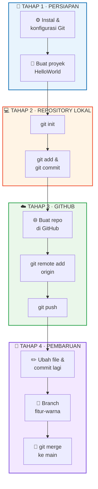

<div align="center">

# 🌐 HelloWorld

### Laporan Praktik: Penggunaan Git dan GitHub dalam Pengelolaan Proyek Pemrograman Web


**Program Studi Teknik Informatika**<br>
Fakultas Teknik dan Ilmu Komputer<br>
**Universitas Nahdlatul Ulama Indonesia (UNUSIA)** · 2026

[📄 Baca Laporan (PDF)](docs/LAPORAN%20PRAKTIK%20PENGGUNAAN%20GIT%20DAN%20GITHUB%20DALAM%20PENGELOLAAN.pdf)
</div>

---

## 📖 Tentang Repository Ini

Repository ini berisi **proyek website sederhana HelloWorld** beserta **laporan praktik** penggunaan **Git** sebagai sistem kontrol versi dan **GitHub** sebagai layanan penyimpanan repository jarak jauh.

Laporan ini disusun sebagai **tugas pengganti mata kuliah Pengolahan Citra Digital**. Proyek dibuat sengaja sederhana agar fokus praktikum tertuju pada **pengelolaan versi**, bukan pada kerumitan kode.

## 👤 Identitas

| | |
|---|---|
| **Nama** | Muhammad Sahal Anwar Hadi |
| **NIM** | 24260032 |
| **Program Studi** | Teknik Informatika |
| **Fakultas** | Teknik dan Ilmu Komputer |
| **Universitas** | Universitas Nahdlatul Ulama Indonesia |
| **Dosen Pengampu** | Bapak Andi Aljabar, S.Kom., M.T.I. |
| **GitHub** | [@Sahal111](https://github.com/Sahal111) |

## 🎯 Tujuan Praktikum

1. Memahami konsep dasar Git, GitHub, dan sistem kontrol versi.
2. Menginstal dan mengonfigurasi Git pada komputer.
3. Membuat proyek web sederhana (HelloWorld) menggunakan Visual Studio Code.
4. Menginisialisasi repository lokal dan mencatat perubahan dengan `git add` dan `git commit`.
5. Membuat repository di GitHub dan menghubungkannya dengan repository lokal.
6. Mengunggah dan memperbarui proyek menggunakan `git push`.
7. Membuat branch baru, lalu menggabungkannya ke branch utama dengan `git merge`.

## 🛠️ Alat dan Bahan

| No | Alat / Bahan | Keterangan |
|:--:|---|---|
| 1 | Komputer | MacBook Air chip Apple M4, macOS Tahoe 26.2 |
| 2 | Visual Studio Code | Editor kode untuk menulis HTML dan CSS |
| 3 | Git | Versi `2.50.1 (Apple Git-155)` |
| 4 | Akun GitHub | Username: `Sahal111` |
| 5 | Browser | Google Chrome |
| 6 | Terminal | Terminal bawaan macOS / terminal terintegrasi VS Code |

## 🗂️ Struktur Repository

```text
HelloWorld/
├── 📄 index.html          # Kerangka halaman website
├── 🎨 styles.css          # Tampilan visual (animasi, efek kaca, bola)
├── 📁 docs/
│   └── Laporan-Praktik-Git-GitHub.pdf   # Laporan lengkap praktikum
└── 📘 README.md
```

## 🚀 Alur Praktikum



### 1️⃣ Persiapan Lingkungan
Instalasi Git (Xcode Command Line Tools / Homebrew), pembuatan akun GitHub, lalu konfigurasi identitas:

```bash
git --version
git config --global user.name "Sahal111"
git config --global user.email "email-anda@gmail.com"
git config --global init.defaultBranch main
```

### 2️⃣ Inisialisasi Repository Lokal

```bash
git init
git status
git add .
git commit -m "Initial commit"
git log --oneline
```

### 3️⃣ Menghubungkan dan Mengunggah ke GitHub

```bash
git remote add origin https://github.com/Sahal111/HelloWorld.git
git branch -M main
git push -u origin main
```

### 4️⃣ Pembaruan File

```bash
git status
git diff
git add index.html
git commit -m "Memperbarui teks paragraf pada halaman utama"
git push
```

### 5️⃣ Branch dan Merge

```bash
git branch
git switch -c fitur-warna
# ... ubah warna bola pada styles.css ...
git add styles.css
git commit -m "Mengubah warna bola pada styles.css"
git switch main
git merge fitur-warna
git push
git branch -d fitur-warna
```

## 📚 Konsep Utama

| Istilah | Pengertian | Perintah |
|---|---|---|
| **Commit** | Merekam kondisi berkas yang telah dipilih ke dalam riwayat repository | `git commit -m "pesan"` |
| **Push** | Mengirim commit dari repository lokal ke remote (GitHub) | `git push` |
| **Pull** | Mengambil dan menggabungkan perubahan terbaru dari remote | `git pull` |
| **Clone** | Menyalin repository jarak jauh beserta riwayatnya ke lokal | `git clone <url>` |
| **Branch** | Cabang pengembangan terpisah dari jalur utama | `git branch`, `git switch` |

### Git vs GitHub

| Aspek | Git | GitHub |
|---|---|---|
| **Jenis** | Perangkat lunak sistem kontrol versi | Layanan hosting repository berbasis web |
| **Lokasi kerja** | Berjalan di komputer lokal | Berjalan secara daring |
| **Fungsi utama** | Mencatat dan mengelola riwayat perubahan | Menyimpan repository daring dan mendukung kolaborasi |
| **Ketergantungan** | Dapat digunakan tanpa GitHub | Memerlukan Git sebagai dasar |

> 💡 **Analogi:** Git adalah mesin yang mencatat riwayat perubahan, sedangkan GitHub adalah tempat penyimpanan daring bagi hasil catatan tersebut.

## ✅ Hasil Akhir

- ✔️ Repository lokal terinisialisasi Git dan memiliki beberapa commit (commit awal, pembaruan teks, dan perubahan warna)
- ✔️ Repository GitHub terhubung dengan repository lokal melalui remote `origin`
- ✔️ File `index.html` dan `styles.css` tersimpan di GitHub dalam versi terbaru
- ✔️ Perubahan dari branch `fitur-warna` telah digabung ke branch `main`
- ✔️ Riwayat perubahan dapat ditelusuri melalui `git log` maupun halaman Commits di GitHub

## 🔍 Evaluasi

**Yang tercakup:** konfigurasi, inisialisasi repository, commit, push, pembaruan file, serta branch dan merge.

**Belum tercakup (materi lanjutan):** penanganan konflik penggabungan, pull request, dan `.gitignore`. Karena proyek dikerjakan sendiri, kolaborasi antar pengembang belum teruji.

## 📝 Kesimpulan

1. **Git** berjalan di komputer lokal untuk mencatat riwayat perubahan, sedangkan **GitHub** menyimpan repository secara daring. Keduanya saling melengkapi.
2. Proyek berhasil dikelola dengan `git init`, `git status`, `git add`, dan `git commit`.
3. Repository lokal berhasil dihubungkan dan diperbarui di GitHub melalui `git remote add origin` dan `git push`.
4. **Branch dan merge** memungkinkan perubahan dikerjakan terpisah tanpa mengganggu versi utama.
5. Dibandingkan menyalin folder secara manual, Git dan GitHub membuat riwayat lebih jelas, versi lebih mudah ditelusuri, dan proyek lebih aman.

## 📖 Daftar Pustaka

- Chacon, S., & Straub, B. (2014). *Pro Git* (2nd ed.). Apress. https://git-scm.com/book/en/v2
- Git. (n.d.). *Git documentation*. https://git-scm.com/doc
- GitHub. (n.d.). *GitHub Docs*. https://docs.github.com
- Ruparelia, N. B. (2010). The history of version control. *ACM SIGSOFT Software Engineering Notes, 35*(1), 5–9. https://doi.org/10.1145/1668862.1668876
- Spinellis, D. (2012). Git. *IEEE Software, 29*(3), 100–101. https://doi.org/10.1109/MS.2012.61

---

<div align="center">

Disusun oleh **Muhammad Sahal Anwar Hadi** · Bogor, 2 November 2026

⭐ Jika repository ini bermanfaat, silakan beri bintang!

</div>
